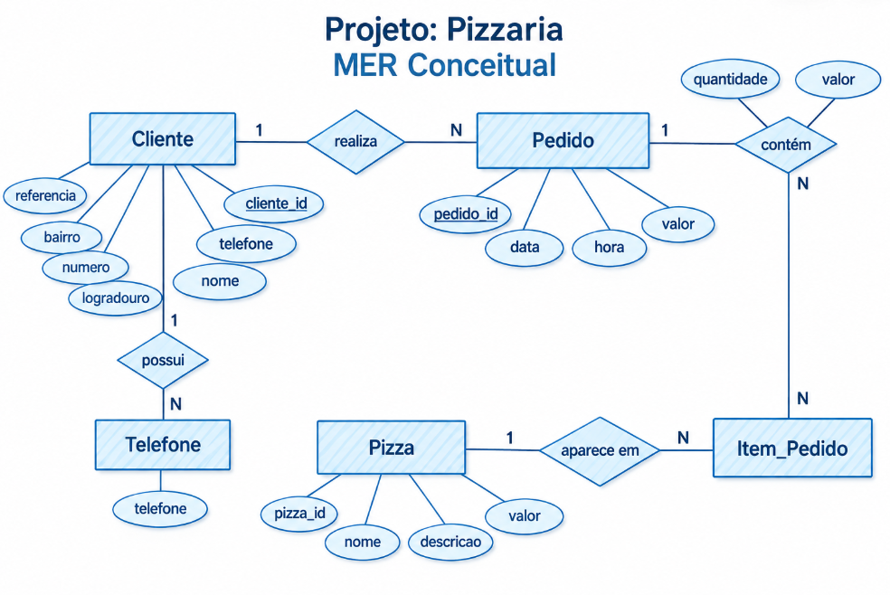
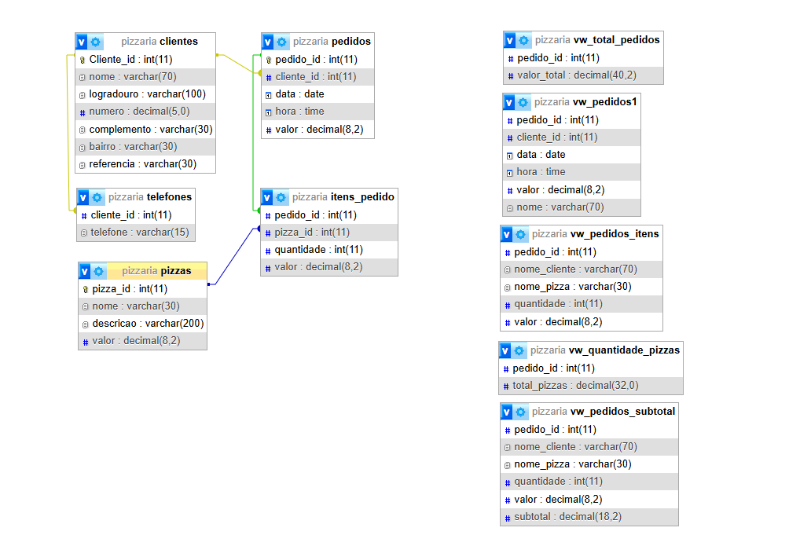

# Aula 09 - Pizzaria

Atividade de criação e manipulação de um banco de dados de uma pizzaria, utilizando consultas SQL, índices e relatórios.

## Conteúdo trabalhado
- Consultas SQL (SELECT e JOIN).
- Criação de índices (INDEX).
- Criação de relatórios (VIEW).
- Inserção e atualização de dados (INSERT e UPDATE).

## Tecnologias
- MySQL
- XAMPP
- phpMyAdmin

## Diagramas do Banco de Dados

### MER Conceitual

### MER Lógico

